# 🧩 مخطط التنقل والحالات - ManyStartActivities (STATE_NAVIGATION_EXPLAINED)

تم تصميم هذا المستند للطلاب الذين يتعلمون تطوير تطبيقات أندرويد بلغة Java، لشرح خريطة التنقل والحالات والانتقالات لتطبيق **ManyStartActivities**.

---

## 1. مخطط الحالات والتنقل (Mermaid stateDiagram-v2)

```mermaid
stateDiagram-v2
    [*] --> MainActivity : تشغيل التطبيق (LAUNCHER)

    state MainActivity {
        [*] --> CatalogView : تحميل 25 بطاقة للأنماط
        CatalogView --> InfoDialogState : النقر على زر Info
        InfoDialogState --> CatalogView : النقر على Got It / إغلاق
    }

    MainActivity --> TargetActivity : النقر على Launch Demo في الحوار
    
    state "variants (Splash Activities)" as SplashVariants {
        StandardSplashActivity : Variant 1 - Standard Timer
        PreloadSplashActivity : Variant 2 - Progress Init
        OnboardingSplashActivity : Variant 3 - ViewPager2
        InteractiveSplashActivity : Variant 4 - Gesture/Tap
        MotionSplashActivity : Variant 5 - AnimatorSet
        SystemSplashActivity : Variant 6 - System Splash API
        FlashlightSplashActivity : Variant 7 - Spotlight Eraser
        AssembleSplashActivity : Variant 8 - Spring Puzzle
        PendulumSplashActivity : Variant 9 - Accelerometer Tilt
        UnboxingSplashActivity : Variant 10 - Ribbon Swipe
        TypewriterSplashActivity : Variant 11 - Typo Correction
        PortalSplashActivity : Variant 12 - RenderEffect Blur
        BreathingSplashActivity : Variant 13 - Hold to Wake
        RitualSplashActivity : Variant 14 - Salt Particles
        ContextualSplashActivity : Variant 15 - Time & Battery
        QuoteSplashActivity : Variant 16 - Shakespeare Quote
        SlideSplashActivity : Variant 17 - Slide to Start
        VideoSplashActivity : Variant 18 - Video Background
        MapSplashActivity : Variant 19 - Map Zoom & Pin
        WebViewSplashActivity : Variant 20 - HTML5 JS Bridge
        ParticleSplashActivity : Variant 21 - SurfaceView Engine
        MoodSplashActivity : Variant 22 - ChipGroup Persona
        BottomSheetSplashActivity : Variant 23 - BottomSheet Behavior
        CameraSplashActivity : Variant 24 - CameraX Preview
        CalendarSplashActivity : Variant 25 - Calendar Streak
    }

    MainActivity --> SplashVariants : النقر على Launch Demo في الكتالوج

    SplashVariants --> TargetActivity : إتمام اللوجيك / المؤقت / الإيماءة / الزر

    state TargetActivity {
        [*] --> DisplayResult : عرض المصدر وآلية المشغل
    }

    TargetActivity --> MainActivity : النقر على Return to Catalog (CLEAR_TOP)
    TargetActivity --> [*] : الخروج من التطبيق / زر العودة
```



---

## 2. كيفية قراءة المخطط

| عنصر المخطط | المعنى |
|---|---|
| `[*]` في البداية | نقطة بدء التطبيق (تشغيل التطبيق من قبل المستخدم). |
| `[*]` في النهاية | نقطة الخروج من التطبيق (إغلاق التطبيق). |
| مستطيل بحواف دائرية | **حالة / Activity:** الشاشة أو الحالة الداخلية التي يتواجد فيها التطبيق حالياً. |
| مستطيل مركب (`state MainActivity { ... }`) | **حالة مركبة:** شاشة مستضيفة تحتوي على حالات داخلية (عرض الكتالوج ومربع حوار المعلومات). |
| سهم الانتقال (`-->`) | **انتقال:** التغير من حالة إلى أخرى بحدث معين. |
| النص على السهم | **حدث / مشغل:** الإجراء الذي تسبب في الانتقال (نقر زر، انتهاء مؤقت، إيماءة). |

---

## 3. الشرح بكلمات بسيطة

### 1. الفكرة الرئيسية
في أي لحظة، يتواجد التطبيق **في حالة أو شاشة واحدة بالضبط**. يحدث الانتقال من حالة إلى أخرى فقط عند وقوع **حدث** (مثل نقر زر أو انتهاء مؤقت).
*للطلاب المتقدمين:* في علوم الحاسوب النظرية، يسمى هذا النموذج **الآلة المحددة ذات الحالات المحدودة (DFA)**.

### 2. التشبيه اليومي: بوابة المترو
تخيل التطبيق مثل **بوابة المترو الذكية**:
- البوابة تكون في **حالة المقفلة**.
- عند تمرير التذكرة (حدث)، تنتقل إلى **حالة המفتوحة**.
- عند العبور، ترجع إلى **حالة المقفلة**.
لا يمكن للبوابة أن تكون مفتوحة ومقفلة في نفس الوقت — هي دائماً في حالة واحدة!

### 3. الجزء 1 — تشغيل التطبيق والكتالوج الرئيسي
عند تشغيل التطبيق، يطلق أندرويد `MainActivity` (المسجلة كـ LAUNCHER في `AndroidManifest.xml`).
داخل `MainActivity` يكون المستخدم في `CatalogView`. عند النقر على "Info"، ينتقل التطبيق إلى `InfoDialogState` لعرض الشرح التعليمي. إغلاق الحوار يعيد المستخدم إلى `CatalogView`.

### 4. الجزء 2 — تنفيذ شاشات البدء
النقر على "Launch Demo" يفتح الـ Activity لشاشة البدء المحددة (`Variant 1`..`25`).
تنفذ كل شاشة منطقها الخاص (מؤقت، مسح الشاشة، الكاميرا، الحساسات).

### 5. الجزء 3 — الانتقال للهدف والعودة
عند اكتمال المنطق، تطلق شاشة البدء `TargetActivity.start(...)` وتستدعي `finish()`.
من `TargetActivity`، النقر على "Return to Catalog" يرسل `Intent` للعودة إلى `MainActivity` مع دالة `FLAG_ACTIVITY_CLEAR_TOP` لتنظيف الذاكرة.

### 6. ربط الكود: كيف يبدو الانتقال في Java؟

```java
// الانتقال من MainActivity إلى شاشة بدء:
Intent intent = new Intent(MainActivity.this, variant.getTargetActivityClass());
startActivity(intent);

// الانتقال من شاشة البدء إلى الهدف وإغلاق المصدر:
TargetActivity.start(this, getString(R.string.v0_title), triggerMechanism);
finish();
```

---

## 4. أسئلة للتحقق الذاتي

1. **قيم الكود:** ما هي المدة الزمنية للمؤقت التلقائي في `StandardSplashActivity` (النمط 1)؟
2. **منطق الكود:** ماذا يحدث في `SlideSplashActivity` (النمط 17) إذا أفرط المستخدم الساحب عند 78% قبل الوصول لـ 100%؟
3. **لماذا:** لماذا يถือ استدعاء `finish()` ضرورياً عند الانتقال من شاشة البدء إلى `TargetActivity`؟
4. **سيناريو التنقل:** ارسم مسار المستخدم الذي يفتح التطبيق، ينقر على Info في النمط 24 (الكاميرا)، يغلق الحوار، ينقر Launch Demo، يمنح الإذن، ويلتقط لقطة ويرجع للكتالوج.
