# 🧩 State & Navigation Diagram - ManyStartActivities (STATE_NAVIGATION_EXPLAINED)

This document is designed for students learning Android application development in Java, explaining the navigation map, states, and screen transitions of **ManyStartActivities**.

---

## 1. State and Navigation Diagram (Mermaid stateDiagram-v2)

```mermaid
stateDiagram-v2
    [*] --> MainActivity : App Launch (LAUNCHER)

    state MainActivity {
        [*] --> CatalogView : Load 25 Variant Cards
        CatalogView --> InfoDialogState : Tap Info Button
        InfoDialogState --> CatalogView : Tap Got It / Close
    }

    MainActivity --> TargetActivity : Tap Launch Demo in Dialog
    
    state "variants (Splash Activities)" as SplashVariants {
        StandardSplashActivity : Variant 1 - Standard Timer
        PreloadSplashActivity : Variant 2 - Progress Init
        OnboardingSplashActivity : Variant 3 - ViewPager2
        InteractiveSplashActivity : Variant 4 - Gesture/Tap
        MotionSplashActivity : Variant 5 - AnimatorSet
        SystemSplashActivity : Variant 6 - System Splash API
        FlashlightSplashActivity : Variant 7 - Spotlight Eraser
        AssembleSplashActivity : Variant 8 - Spring Puzzle
        PendulumSplashActivity : Variant 9 - Accelerometer Tilt
        UnboxingSplashActivity : Variant 10 - Ribbon Swipe
        TypewriterSplashActivity : Variant 11 - Typo Correction
        PortalSplashActivity : Variant 12 - RenderEffect Blur
        BreathingSplashActivity : Variant 13 - Hold to Wake
        RitualSplashActivity : Variant 14 - Salt Particles
        ContextualSplashActivity : Variant 15 - Time & Battery
        QuoteSplashActivity : Variant 16 - Shakespeare Quote
        SlideSplashActivity : Variant 17 - Slide to Start
        VideoSplashActivity : Variant 18 - Video Background
        MapSplashActivity : Variant 19 - Map Zoom & Pin
        WebViewSplashActivity : Variant 20 - HTML5 JS Bridge
        ParticleSplashActivity : Variant 21 - SurfaceView Engine
        MoodSplashActivity : Variant 22 - ChipGroup Persona
        BottomSheetSplashActivity : Variant 23 - BottomSheet Behavior
        CameraSplashActivity : Variant 24 - CameraX Preview
        CalendarSplashActivity : Variant 25 - Calendar Streak
    }

    MainActivity --> SplashVariants : Tap Launch Demo Card Button

    SplashVariants --> TargetActivity : Completion / Timer / Gesture / Button

    state TargetActivity {
        [*] --> DisplayResult : Display Source & Trigger Extra Payload
    }

    TargetActivity --> MainActivity : Tap Return to Catalog (CLEAR_TOP)
    TargetActivity --> [*] : Exit App / Back Press
```



---

## 2. How to Read the Diagram

| Diagram Element | Meaning |
|---|---|
| `[*]` at Start | Application entry point (app launch by user). |
| `[*]` at End | Application exit point (closing the app). |
| Rounded Box | **State / Activity:** Screen or inner state the app is in at a given moment. |
| Compound Box (`state MainActivity { ... }`) | **Compound State:** A host screen containing inner states (catalog view and info dialog). |
| Transition Arrow (`-->`) | **Transition:** Change from one state to another triggered by an event. |
| Text on Arrow | **Event / Trigger:** Action that caused the transition (button click, timer completion, swipe gesture, sensor tilt). |

---

## 3. Explanation in Simple Words

### 1. Main Concept
At any given moment, the application is in **exactly one state or screen**. Transitioning from one state to another happens if and only if a specific **event** occurs (such as a button tap, timer expiration, or gesture).
*For advanced students:* In theoretical computer science, this execution model is called a **Deterministic Finite Automaton (DFA)**.

### 2. Everyday Analogy: Subway Turnstile / Elevator
Think of the app like a **subway turnstile**:
- The turnstile is in the **Locked state**.
- When you tap your ticket (event), it transitions to the **Unlocked state**.
- When you walk through, it returns to the **Locked state**.
The turnstile can never be both locked and unlocked at the same time — it is always in exactly one state!

### 3. Part 1 — App Launch & Main Catalog
When the user taps the app icon, the Android system launches `MainActivity` (registered as LAUNCHER in `AndroidManifest.xml`).
Inside `MainActivity`, the user resides in `CatalogView`. Tapping an "Info" button transitions to `InfoDialogState` showing educational explanations. Closing the dialog returns to `CatalogView`.

### 4. Part 2 — Splash Screen Execution & Triggers
Tapping "Launch Demo" on any card transitions the user to the corresponding splash screen Activity (`Variant 1`..`25`).
Each splash screen executes its custom logic:
- **Variant 1 (Standard):** Runs a 7-second `CountDownTimer`.
- **Variant 2 (Preload):** Advances a `LinearProgressIndicator` to 100%.
- **Variant 10 (Unboxing):** Waits for a downward ribbon swipe gesture.
- **Variant 24 (Camera):** Binds CameraX front camera feed and waits for a snap tap.

### 5. Part 3 — Destination Transition & Return
Once splash screen logic completes, it invokes `TargetActivity.start(...)` and calls `finish()`.
From `TargetActivity`, tapping "Return to Catalog" triggers an `Intent` back to `MainActivity` with `FLAG_ACTIVITY_CLEAR_TOP`, clearing destination screens from memory and returning the user to the catalog.

### 6. Code Connection: How Transitions Look in Java

**Example 1: Launching a Splash Variant from MainActivity**
```java
Intent intent = new Intent(MainActivity.this, variant.getTargetActivityClass());
startActivity(intent);
```

**Example 2: Navigating from Splash Screen to Destination and Finishing Source**
```java
public static void start(Context context, String sourceVariant, String triggerMechanism) {
    Intent intent = new Intent(context, TargetActivity.class);
    intent.putExtra(EXTRA_SOURCE_VARIANT, sourceVariant);
    intent.putExtra(EXTRA_TRIGGER_MECHANISM, triggerMechanism);
    context.startActivity(intent);
}

// Inside Splash Activity:
TargetActivity.start(this, getString(R.string.v0_title), triggerMechanism);
finish(); // Closes the splash Activity so it doesn't linger in memory!
```

### 7. Why Draw a State Diagram?
A state diagram lets you see all user paths in one view, catch dead ends, and verify state transition completeness.

### 8. Common Student Mistakes
1. **Forgetting `finish()`:** If you forget `finish()` on a splash screen, pressing "Back" will return the user to the splash screen instead of the catalog.
2. **Confusing Activity with Dialog:** A dialog floats on top of an existing screen, while an Activity is a brand new screen.
3. **Accumulating Screens in Memory:** Re-launching activities without clearing flags (`FLAG_ACTIVITY_CLEAR_TOP`) causes memory stack bloat.

---

## 4. Self-Check Questions

1. **Code Values:** What is the exact countdown timer duration in `StandardSplashActivity` (Variant 1)?
2. **Code Logic:** What happens in `SlideSplashActivity` (Variant 17) if the user releases the slider at 78% before reaching 100%?
3. **Why:** Why is calling `finish()` crucial when transitioning from a splash screen to `TargetActivity`?
4. **Navigation Scenario:** Draw the path of a user who opens the app, taps "Info" on Variant 24 (Camera), closes the dialog, taps "Launch Demo", grants camera permission, taps screen to snap, and returns to catalog.
5. **What Would Change:** What happens to navigation in `QuoteSplashActivity` (Variant 16) if we remove `SharedPreferences` persistence?
