# 🧩 דיאגרמת ניווט ומצבים - ManyStartActivities (STATE_NAVIGATION_EXPLAINED)

מסמך זה מיועד לתלמידים הלומדים פיתוח אפליקציות באנדרואיד ב-Java, ומסביר את מפת הניווט, המצבים והמעברים של האפליקציה **ManyStartActivities**.

---

## 1. דיאגרמת מצבים וניווט (Mermaid stateDiagram-v2)

```mermaid
stateDiagram-v2
    [*] --> MainActivity : הפעלת האפליקציה (LAUNCHER)

    state MainActivity {
        [*] --> CatalogView : טעינת קטלוג 25 התבניות
        CatalogView --> InfoDialogState : לחיצה על כפתור Info
        InfoDialogState --> CatalogView : לחיצה על Got It / סגירה
    }

    MainActivity --> TargetActivity : לחיצה על Launch Demo בתוך הדיאלוג
    
    state "variants (Splash Activities)" as SplashVariants {
        StandardSplashActivity : Variant 1 - Standard Timer
        PreloadSplashActivity : Variant 2 - Progress Init
        OnboardingSplashActivity : Variant 3 - ViewPager2
        InteractiveSplashActivity : Variant 4 - Gesture/Tap
        MotionSplashActivity : Variant 5 - AnimatorSet
        SystemSplashActivity : Variant 6 - System Splash API
        FlashlightSplashActivity : Variant 7 - Spotlight Eraser
        AssembleSplashActivity : Variant 8 - Spring Puzzle
        PendulumSplashActivity : Variant 9 - Accelerometer Tilt
        UnboxingSplashActivity : Variant 10 - Ribbon Swipe
        TypewriterSplashActivity : Variant 11 - Typo Correction
        PortalSplashActivity : Variant 12 - RenderEffect Blur
        BreathingSplashActivity : Variant 13 - Hold to Wake
        RitualSplashActivity : Variant 14 - Salt Particles
        ContextualSplashActivity : Variant 15 - Time & Battery
        QuoteSplashActivity : Variant 16 - Shakespeare Quote
        SlideSplashActivity : Variant 17 - Slide to Start
        VideoSplashActivity : Variant 18 - Video Background
        MapSplashActivity : Variant 19 - Map Zoom & Pin
        WebViewSplashActivity : Variant 20 - HTML5 JS Bridge
        ParticleSplashActivity : Variant 21 - SurfaceView Engine
        MoodSplashActivity : Variant 22 - ChipGroup Persona
        BottomSheetSplashActivity : Variant 23 - BottomSheet Behavior
        CameraSplashActivity : Variant 24 - CameraX Preview
        CalendarSplashActivity : Variant 25 - Calendar Streak
    }

    MainActivity --> SplashVariants : לחיצה על כפתור Launch Demo בכרטיסייה

    SplashVariants --> TargetActivity : סיום לוגיקה / טיימר / ג'סטה / כפתור

    state TargetActivity {
        [*] --> DisplayResult : הצגת מקור המעבר והטריגר
    }

    TargetActivity --> MainActivity : לחיצה על Return to Catalog (CLEAR_TOP)
    TargetActivity --> [*] : יציאה מהאפליקציה / כפתור Back
```



---

## 2. איך לקרוא את הדיאגרמת

| אלמנט בדיאגרמה | מה זה אומר? |
|---|---|
| `[*]` בהתחלה | נקודת ההתחלה של האפליקציה (הפעלת האפליקציה על ידי המשתמש). |
| `[*]` בסוף | נקודת היציאה מהאפליקציה (סגירת האפליקציה). |
| מלבן פינות מעוגלות | **מצב (State) / Activity:** מסך או מצב פנימי שבו האפליקציה נמצאת באותו רגע. |
| מלבן מורכב (`state MainActivity { ... }`) | **מצב מורכב (Compound State):** מסך ראשי שמכיל בתוכו מצבים פנימיים (תצוגת קטלוג ודיאלוג מידע). |
| חץ מעבר (`-->`) | **מעבר (Transition):** שינוי ממצב אחד למצב אחר עקב אירוע. |
| כיתוב על חץ | **אירוע / טריגר (Trigger):** הפעולה שגרמה למעבר (כמו לחיצה על כפתור, סיום טיימר, החלקת אצבע או חיישן). |

---

## 3. הסבר במילים פשוטות

### 1. הרעיון המרכזי
בכל רגע נתון, האפליקציה נמצאת בדיוק **במסך או במצב אחד**. מעבר ממצב אחד למצב אחר קורה אך ורק כאשר מתרחש **אירוע** (כמו לחיצת כפתור, סיום טיימר או מחווה של המשתמש).
*לתלמידים חזקים:* במדעי המחשב התיאורטיים, מודל זה נקרא **אוטומט סופי דטרמיניסטי (DFA - Deterministic Finite Automaton)**.

### 2. אנלוגיה יומיומית: מחסום חכם במטרו / מעלית
חשבו על האפליקציה כמו על **מחסום חכם בתחנת רכבת**:
- המחסום נמצא ב**מצב המתנה** (סגור).
- כשאנחנו מעבירים כרטיס (אירוע), המחסום עובר ל**מצב פתוח**.
- כשאנחנו עוברים, המחסום חוזר ל**מצב סגור**.
המחסום לא יכול להיות גם פתוח וגם סגור באותו הזמן — הוא תמיד בדיוק במצב אחד!

### 3. חלק 1 — הפעלת האפליקציה והקטלוג הראשי
כאשר המשתמש לוחץ על אייקון האפליקציה, מערכת אנדרואיד מפעילה את `MainActivity` (המוגדרת כ-LAUNCHER ב-`AndroidManifest.xml`).
בתוך `MainActivity`, המשתמש נמצא ב-`CatalogView`. בלחיצה על כפתור "Info", האפליקציה עוברת למצב דיאלוג `InfoDialogState` המציג את ההסבר הפדגוגי. סגירת הדיאלוג מחזירה את המשתמש בחזרה ל-`CatalogView`.

### 4. חלק 2 — הפעלת מסכי הפתיחה והחייתם
בלחיצה על כפתור "Launch Demo" בכרטיסייה, המשתמש עובר ל-Activity של מסך הפתיחה הנבחר (אחד מתוך 25 ה-Variants).
כל מסך פתיחה פועל לפי לוגיקה ייחודית:
- **Variant 1 (Standard):** מריץ `CountDownTimer` של 7 שניות.
- **Variant 2 (Preload):** מקדם `LinearProgressIndicator` עד 100%.
- **Variant 10 (Unboxing):** ממתין לג'סטת סווייפ למטה.
- **Variant 24 (Camera):** מפעיל מצלמה קדמית וממתין לטאפ צילום.

### 5. חלק 3 — המעבר למסך היעד והחזרה
ברגע שלוגיקת מסך הפתיחה הושלמה (או שהמשתמש לחץ על כפתור מעבר), המסך מפעיל את `TargetActivity.start(...)` וקורא ל-`finish()`.
ממסך היעד `TargetActivity`, לחיצה על "Return to Catalog" מפעילה `Intent` חזרה ל-`MainActivity` עם הדגל `FLAG_ACTIVITY_CLEAR_TOP`, המנקה את המסכים הקודמים מהזיכרון ומחזיר את המשתמש לקטלוג.

### 6. קשר לקוד: איך מעבר נראה ב-Java?

**דוגמה 1: מעבר מ-MainActivity למסך פתיחה בעזרת Intent**
```java
Intent intent = new Intent(MainActivity.this, variant.getTargetActivityClass());
startActivity(intent);
```

**דוגמה 2: מעבר ממסך פתיחה למסך היעד וסגירת מסך המקור**
```java
public static void start(Context context, String sourceVariant, String triggerMechanism) {
    Intent intent = new Intent(context, TargetActivity.class);
    intent.putExtra(EXTRA_SOURCE_VARIANT, sourceVariant);
    intent.putExtra(EXTRA_TRIGGER_MECHANISM, triggerMechanism);
    context.startActivity(intent);
}

// בתוך מסך הפתיחה:
TargetActivity.start(this, getString(R.string.v0_title), triggerMechanism);
finish(); // סגירת מסך הפתיחה כדי שלא יישאר ברקע!
```

### 7. למה כדאי לשרטט דיאגרמת מצבים?
דיאגרמת מצבים מאפשרת לראות את כל המסלולים של המשתמש במקום אחד, לזהות "מבואות סתומים" (מסכים שאי אפשר לצאת מהם) ולדאוג שכל אירוע מקבל טיפול נכון בקוד.

### 8. טעויות נפוצות של תלמידים
1. **שכחת `finish()`:** אם לא קוראים ל-`finish()` במסך הפתיחה, בלחיצה על כפתור "Back" המשתמש יחזור שוב למסך הפתיחה במקום לקטלוג.
2. **בלבול בין Activity לדיאלוג:** דיאלוג הוא חלון צף מעל המסך הקיים, בעוד ש-Activity היא מסך חדש לחלוטין במערכת.
3. **הצטברות מסכים בזיכרון:** מעברים חוזרים ונשנים ללא דגלי ניקוי (`FLAG_ACTIVITY_CLEAR_TOP`) עלולים להעמיס על זיכרון המכשיר.

---

## 4. שאלות לבדיקה עצמית

1. **ערכים מהקוד:** כמה שניות קצובות בטיימר האוטומטי ב-`StandardSplashActivity` (Variant 1)?
2. **לוגיקה בקוד:** מה קורה ב-`SlideSplashActivity` (Variant 17) אם המשתמש משחרר את הסליידר ב-78% לפני שהגיע ל-100%?
3. **למה:** מדוע חשוב לקרוא ל-`finish()` כאשר עוברים ממסך פתיחה ל-`TargetActivity`?
4. **תרחיש ניווט:** שרטטו את מסלול המשתמש שפותח את האפליקציה, לוחץ על כפתור "Info" בתבנית 24 (Camera), סוגר אותו, לוחץ על "Launch Demo", מאשר הרשאת מצלמה, לוחץ על המסך למעבר וחוזר לקטלוג.
5. **מה ישתנה אם:** מה יקרה בלוגיקת הניווט של `QuoteSplashActivity` (Variant 16) אם נמחק את השמירה ל-`SharedPreferences`?
