# 🧩 Диаграмма состояний и навигации - ManyStartActivities (STATE_NAVIGATION_EXPLAINED)

Данное руководство предназначено для учащихся, изучающих разработку Android-приложений на Java, и объясняет карту навигации, состояния и переходы в приложении **ManyStartActivities**.

---

## 1. Диаграмма состояний и навигации (Mermaid stateDiagram-v2)

```mermaid
stateDiagram-v2
    [*] --> MainActivity : Запуск приложения (LAUNCHER)

    state MainActivity {
        [*] --> CatalogView : Загрузка 25 карточек вариантов
        CatalogView --> InfoDialogState : Нажатие кнопки Info
        InfoDialogState --> CatalogView : Нажатие Got It / Закрытие
    }

    MainActivity --> TargetActivity : Нажатие Launch Demo в диалоге
    
    state "variants (Splash Activities)" as SplashVariants {
        StandardSplashActivity : Variant 1 - Standard Timer
        PreloadSplashActivity : Variant 2 - Progress Init
        OnboardingSplashActivity : Variant 3 - ViewPager2
        InteractiveSplashActivity : Variant 4 - Gesture/Tap
        MotionSplashActivity : Variant 5 - AnimatorSet
        SystemSplashActivity : Variant 6 - System Splash API
        FlashlightSplashActivity : Variant 7 - Spotlight Eraser
        AssembleSplashActivity : Variant 8 - Spring Puzzle
        PendulumSplashActivity : Variant 9 - Accelerometer Tilt
        UnboxingSplashActivity : Variant 10 - Ribbon Swipe
        TypewriterSplashActivity : Variant 11 - Typo Correction
        PortalSplashActivity : Variant 12 - RenderEffect Blur
        BreathingSplashActivity : Variant 13 - Hold to Wake
        RitualSplashActivity : Variant 14 - Salt Particles
        ContextualSplashActivity : Variant 15 - Time & Battery
        QuoteSplashActivity : Variant 16 - Shakespeare Quote
        SlideSplashActivity : Variant 17 - Slide to Start
        VideoSplashActivity : Variant 18 - Video Background
        MapSplashActivity : Variant 19 - Map Zoom & Pin
        WebViewSplashActivity : Variant 20 - HTML5 JS Bridge
        ParticleSplashActivity : Variant 21 - SurfaceView Engine
        MoodSplashActivity : Variant 22 - ChipGroup Persona
        BottomSheetSplashActivity : Variant 23 - BottomSheet Behavior
        CameraSplashActivity : Variant 24 - CameraX Preview
        CalendarSplashActivity : Variant 25 - Calendar Streak
    }

    MainActivity --> SplashVariants : Нажатие Launch Demo на карточке

    SplashVariants --> TargetActivity : Завершение / Таймер / Жест / Кнопка

    state TargetActivity {
        [*] --> DisplayResult : Отображение источника и триггера
    }

    TargetActivity --> MainActivity : Нажатие Return to Catalog (CLEAR_TOP)
    TargetActivity --> [*] : Выход из приложения / Кнопка Назад
```



---

## 2. Как читать диаграмму

| Элемент диаграммы | Что это значит? |
|---|---|
| `[*]` в начале | Точка входа в приложение (запуск пользователем). |
| `[*]` в конце | Точка выхода из приложения (закрытие). |
| Прямоугольник с закругленными углами | **Состояние / Activity:** Экран или внутреннее состояние, в котором находится приложение. |
| Составной прямоугольник (`state MainActivity { ... }`) | **Составное состояние:** Главный экран, содержащий внутренние состояния (каталог и диалог). |
| Стрелка перехода (`-->`) | **Переход:** Смена состояния, вызванная событием. |
| Текст на стрелке | **Событие / Триггер:** Действие, вызвавшее переход (клик кнопки, таймер, жест, датчик). |

---

## 3. Объяснение простыми словами

### 1. Главная идея
В любой момент времени приложение находится **ровно в одном состоянии или экране**. Переход из одного состояния в другое происходит только тогда, когда случается **событие** (нажатие кнопки, завершение таймера, жест).
*Для сильных учащихся:* В теоретической информатике эта модель называется **Детерминированным конечным автоматом (DFA)**.

### 2. Житейская аналогия: Турникет в метро
Представьте приложение как **турникет в метро**:
- Турникет находится в **Заблокированном состоянии**.
- Когда вы прикладываете билет (событие), он переходит в **Разблокированное состояние**.
- Когда вы проходите, он возвращается в **Заблокированное состояние**.
Турникет не может быть одновременно открыт и закрыт — он всегда ровно в одном состоянии!

### 3. Часть 1 — Запуск приложения и главный каталог
При нажатии на иконку Android запускает `MainActivity` (зарегистрированную как LAUNCHER в `AndroidManifest.xml`).
Внутри `MainActivity` пользователь находится в `CatalogView`. Нажатие кнопки «Info» переводит в `InfoDialogState` с учебным описанием. Закрытие диалога возвращает в `CatalogView`.

### 4. Часть 2 — Выполнение стартовых экранов
Нажатие «Launch Demo» запускает соответствующую Activity стартового экрана (`Variant 1`..`25`).
Каждый экран выполняет свою логику:
- **Variant 1 (Standard):** Запускает `CountDownTimer` на 7 секунд.
- **Variant 2 (Preload):** Двигает `LinearProgressIndicator` до 100%.
- **Variant 10 (Unboxing):** Ждет свайпа ленты вниз.
- **Variant 24 (Camera):** Подключает CameraX и ждет клика.

### 5. Часть 3 — Переход на финиш и возврат
По завершении логики стартовый экран вызывает `TargetActivity.start(...)` и закрывается через `finish()`.
На `TargetActivity` нажатие «Return to Catalog» отправляет `Intent` с флагом `FLAG_ACTIVITY_CLEAR_TOP`, возвращая пользователя в каталог `MainActivity`.

### 6. Связь с кодом: Как переход выглядит в Java?

**Пример 1: Запуск стартового экрана из MainActivity**
```java
Intent intent = new Intent(MainActivity.this, variant.getTargetActivityClass());
startActivity(intent);
```

**Пример 2: Переход со стартового экрана на целевой с закрытием источника**
```java
public static void start(Context context, String sourceVariant, String triggerMechanism) {
    Intent intent = new Intent(context, TargetActivity.class);
    intent.putExtra(EXTRA_SOURCE_VARIANT, sourceVariant);
    intent.putExtra(EXTRA_TRIGGER_MECHANISM, triggerMechanism);
    context.startActivity(intent);
}

// Внутри стартового экрана:
TargetActivity.start(this, getString(R.string.v0_title), triggerMechanism);
finish(); // Закрываем стартовый экран, чтобы он не висел в памяти!
```

### 7. Зачем чертить диаграмму состояний?
Диаграмма состояний позволяет увидеть все пути пользователя в одном месте, найти «тупики» и убедиться в полноте логики.

### 8. Частые ошибки учащихся
1. **Забыли `finish()`:** Если не вызвать `finish()` на стартовом экране, кнопка «Назад» вернет пользователя обратно на стартовый экран.
2. **Путаница между Activity и Dialog:** Диалог всплывает поверх экрана, а Activity — это полностью новый экран.
3. **Накопление экранов в стеке:** Переходы без флага `FLAG_ACTIVITY_CLEAR_TOP` перегружают память устройства.

---

## 4. Вопросы для самопроверки

1. **Значения из кода:** Какова точная длительность автотаймера в `StandardSplashActivity` (Variant 1)?
2. **Логика кода:** Что произойдет в `SlideSplashActivity` (Variant 17), если пользователь отпустит слайдер на 78%?
3. **Зачем:** Почему вызов `finish()` критически важен при переходе со стартового экрана на `TargetActivity`?
4. **Сценарий:** Начертите путь пользователя, который открывает приложение, нажимает «Info» на Варианте 24 (Camera), закрывает диалог, нажимает «Launch Demo», разрешает камеру, сдергивает кадр и возвращается в каталог.
5. **Что изменится:** Что произойдет с навигацией в `QuoteSplashActivity` (Variant 16), если мы удалим работу с `SharedPreferences`?
